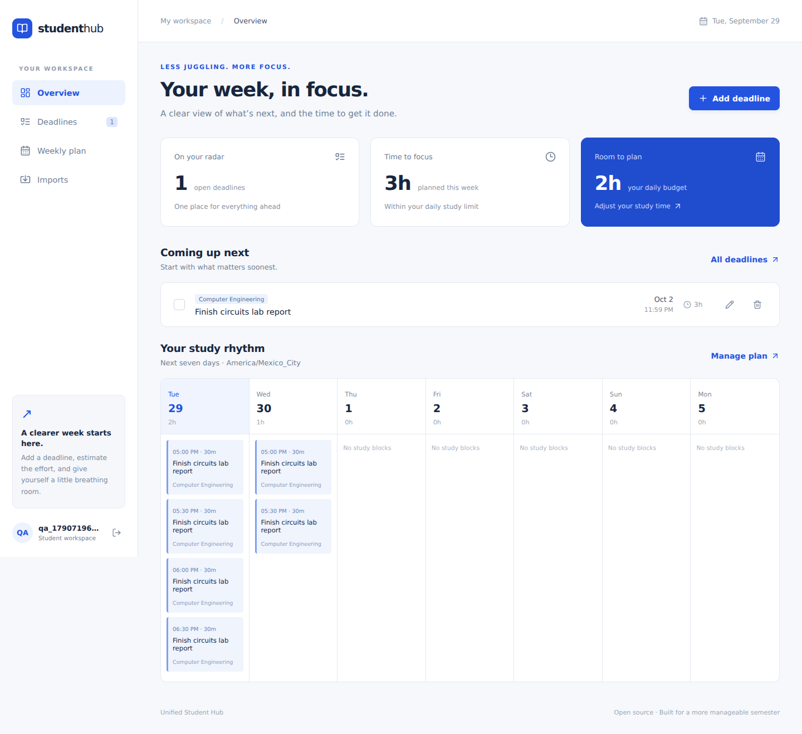

# Unified Student Hub

Unified Student Hub is an open source student workspace I'm building to keep schoolwork in one place.

The goal is simple: add what you need to finish, tell the app when you are free, and let it help you build a realistic study week.

**Live beta:** https://unified-student-hub-vg2s.vercel.app/

React · FastAPI · PostgreSQL · SQLite for local development · MIT license



## What it can do

- Create, edit, complete, search, and delete deadlines
- Organize work by course
- Estimate how much study time is left for each task
- Build a weekly study plan around your available hours
- Add recurring classes and other weekly commitments
- Import syllabus files and calendars
- Preview Canvas and Moodle coursework before saving it
- Store PDFs, presentations, documents, spreadsheets, text files, and images on your device
- Read and annotate PDFs
- Use a built in focus and break timer
- Export deadlines to a calendar
- Save study preferences to your account
- Use parts of the app offline and sync supported changes later
- Use optional reminders while the app is open
- Export account data and create a recovery code

This is still an early beta. I am actively improving the interface, onboarding, and deployment setup. If something feels confusing, that feedback is useful.

## First time using it

A simple way to start is:

1. Add a deadline.
2. Open **Weekly plan** and save the hours you are usually free to study.
3. Review the plan and adjust your schedule if needed.

If you only want to explore the app, use **Try sample deadlines** on the Overview page. The sample items are clearly labeled and can be removed together without touching your real coursework.

## Quick start with Docker

Install Docker with Compose, clone the repository, and open a terminal in the project folder.

```bash
cp .env.example .env
python -c "import secrets; print(secrets.token_hex(24))"
```

On Windows PowerShell, use:

```powershell
Copy-Item .env.example .env
```

Put the generated value into `POSTGRES_PASSWORD` in `.env`.

Start the app:

```bash
docker compose up --build -d
```

Open **http://localhost:8000**.

API documentation is available at **http://localhost:8000/docs**.

Useful commands:

```bash
docker compose logs -f app
docker compose down
```

The database survives normal stops. `docker compose down -v` removes the database volume, so only use it when you actually want to erase local data.

## Local development without Docker

You need Python 3.12 and Node.js 22 or newer.

Create a virtual environment:

```bash
python -m venv .venv
```

Activate it:

```bash
# Windows PowerShell
.venv\Scripts\Activate.ps1

# macOS / Linux
source .venv/bin/activate
```

Install dependencies and start the backend:

```bash
pip install -r backend/requirements.txt
npm ci --prefix frontend
npm run build --prefix frontend
cd backend
uvicorn app.main:app --host 127.0.0.1 --port 8000
```

Local development uses SQLite at `backend/hub.db`, so you do not need to set up PostgreSQL just to work on the project.

For frontend hot reload, run this from another terminal at the repository root:

```bash
npm run dev --prefix frontend
```

Vite forwards `/api` requests to FastAPI on port 8000.

## Imports

### Syllabus and calendar files

The app can preview text based PDF or TXT syllabi and ICS calendar files before anything is saved.

Supported syllabus dates include `YYYY-MM-DD` and full English month dates such as `January 2, 2030`.

Scanned PDFs are not supported yet.

Recurring ICS events are skipped with a warning. Use expanded calendar occurrences or add recurring classes manually in the app.

### Canvas and Moodle

The server owner must allow trusted school hostnames through `LMS_ALLOWED_HOSTS`.

Example:

```dotenv
LMS_ALLOWED_HOSTS=university.instructure.com,moodle.university.edu
```

Canvas and Moodle tokens are used for the current request and are not intentionally stored by the app.

School APIs differ, so always review the import preview before saving.

## Study planner

The planner is deterministic. It is not an AI prediction.

It looks at:

- deadlines
- remaining study minutes
- available study hours
- busy calendar events
- recurring classes
- daily study limits

It schedules work in small blocks and warns when the selected week cannot fit everything.

Completing work does not happen automatically. Update the task or log study minutes as you make progress.

## Offline study

On a personal device, choose **Enable offline access** while you are connected.

Offline mode can keep supported deadlines, preferences, planning data, and locally stored study materials available on the same browser and device.

Materials are device only. They do not automatically sync across devices.

Use the Materials backup feature before clearing browser data.

More details are in [Offline Study](docs/OFFLINE_STUDY.md).

## Deployment

The repository supports several ways to run the project.

For the current hosted beta, see [Vercel deployment](docs/VERCEL.md).

For Render and Neon, see [Render + Neon](docs/RENDER_NEON.md).

For self hosting, see [Deployment Notes](docs/DEPLOYMENT.md).

GitHub Pages cannot run the FastAPI and PostgreSQL backend by itself.

## Tests

From the repository root:

```bash
cd backend
python -m pytest -q
cd ..
npm ci --prefix frontend
npm run build --prefix frontend
```

The repository also includes browser smoke tests and GitHub Actions checks.

## Project docs

[Architecture](docs/ARCHITECTURE.md) · [Contributing](CONTRIBUTING.md) · [Security](SECURITY.md) · [Verification](docs/VERIFICATION.md)

## Roadmap

Some things I still want to improve:

- recurring ICS expansion
- clearer study history and analytics
- OAuth based integrations
- scheduled sync
- email recovery and campus SSO
- versioned database migrations
- larger deployment testing
- simpler onboarding and navigation

Contributions and feedback are welcome.
